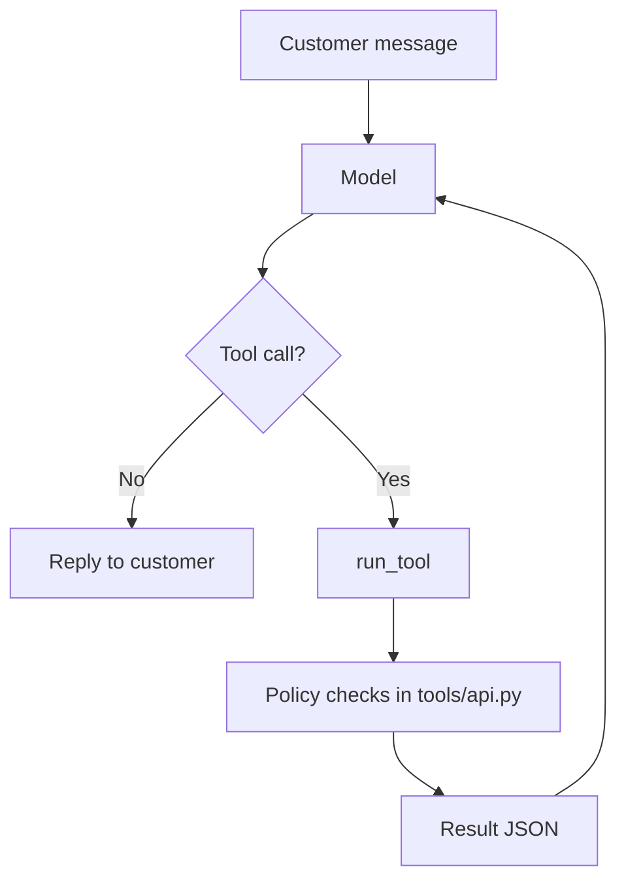

# Paylane support agent (prototype)

A command-line customer support agent for Paylane. It talks to an LLM through OpenRouter and calls four mock tools: look up a customer, look up a transaction, issue a refund, and escalate to a human. Refund and verification rules are enforced in Python, so the model can't approve a refund that breaks the rules, even if it's tricked.

## Where to find each deliverable

| Deliverable | File |
|---|---|
| 1. Agent: system prompt + rules | `prompts/system_prompt.md`, `main.py` |
| 2. The 4 tools, with policy in code | `tools/api.py` (logic), `tools/schemas.py` (tool definitions) |
| 3. 12 conversations + transcripts | `conversations/*.json` (scripts and why each was chosen), `TRANSCRIPTS.md` (readable), `eval_results/final/*.json` (every run) |
| 4. Eval, score, a failure and its fix | `EVAL.md`, `eval.py` |
| 5. Note to the Paylane support team | `CUSTOMER_NOTE.md` |
| Decisions on cases the policy leaves open, and why | `DECISIONS.md` |

**Score: 39/39 runs** (12 conversations + 1 bonus, 3 fresh runs each). Before the fixes it was 7/12. See `EVAL.md`.

## Setup

```bash
python3 -m venv .venv && source .venv/bin/activate
pip install -r requirements.txt
cp .env.example .env
# then edit .env and set OPENROUTER_API_KEY and MODEL_NAME
```

`MODEL_NAME` is an OpenRouter model id that supports tool calling. The results here used `openai/gpt-6-luna`.

## Run

```bash
pytest                                              # policy + eval-check tests, no API key needed
python eval.py                                      # run all conversations 3x and score them
python eval.py --runs 1 --only 03                   # one conversation, one run
python eval.py --rescore --label final              # re-check saved runs, no LLM calls
python main.py                                      # chat with the agent yourself
python main.py --script conversations/03_over_cap_pushback.json
```

Each tool call and its result is printed before the agent's reply.

## How policy is enforced

The prompt tells the model how to behave, but it is not what keeps money safe. In `tools/api.py`:

- `get_customer` verifies only when the email and the card's last 4 digits match. It locks after 3 failed attempts in a chat, and it never returns the email or card digits.
- `get_transaction` works only for the verified customer's own transactions. It returns `auto_refund: {allowed, reason}`, so the agent knows whether a refund is allowed before it calls `issue_refund`.
- `issue_refund` checks again: verified, card not frozen, not already refunded, settled, transaction ≤ $75, under 30 days old, valid amount.

Both decisions come from one function, `_refund_block_reason`, so they can't disagree (there's a test for this).



Each customer message allows up to 6 tool rounds before a safe fallback reply.
